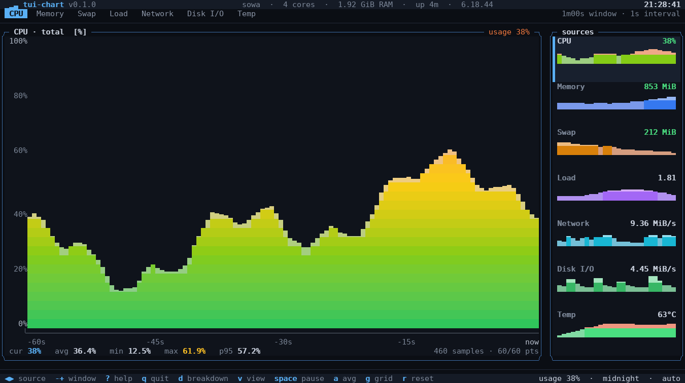
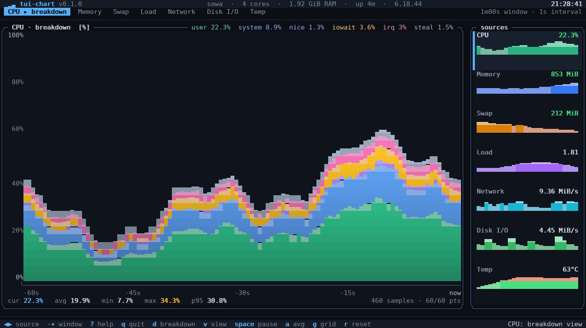
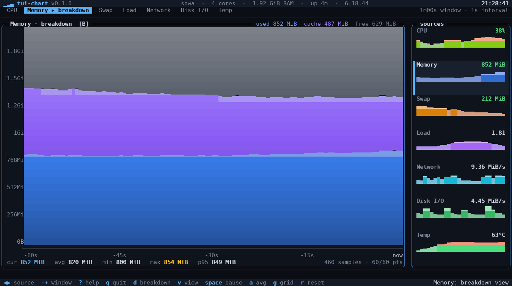
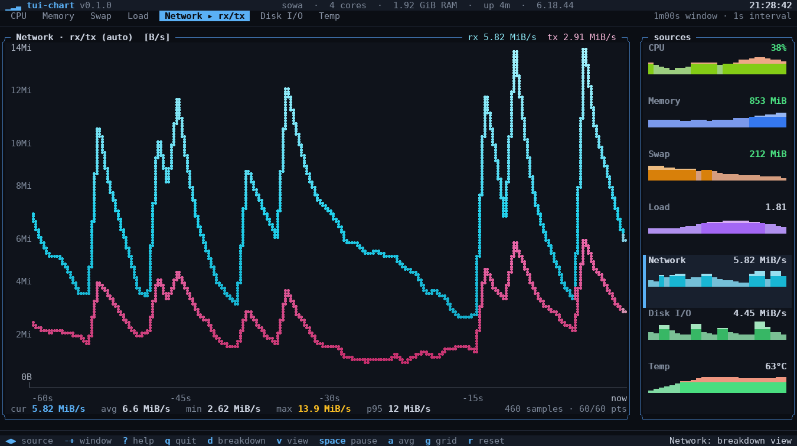
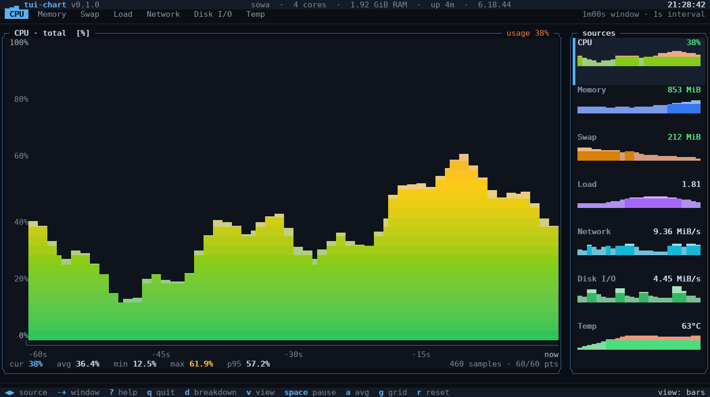
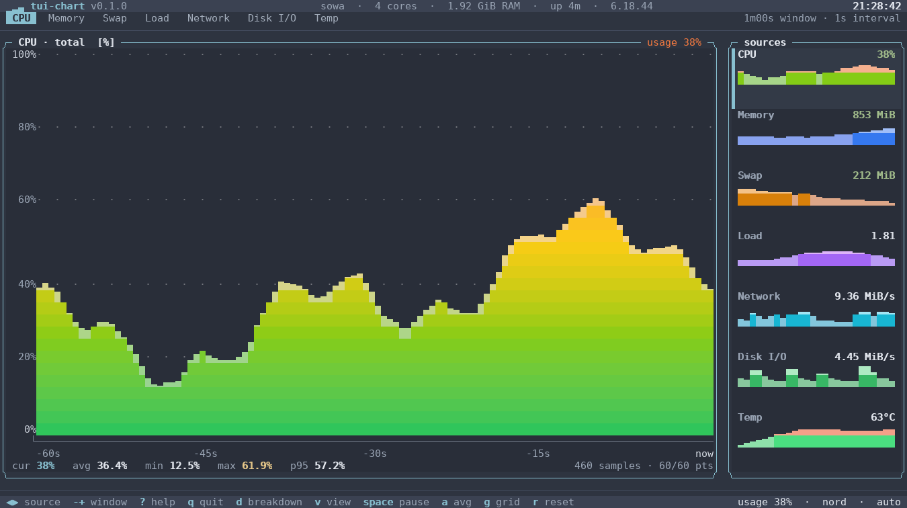
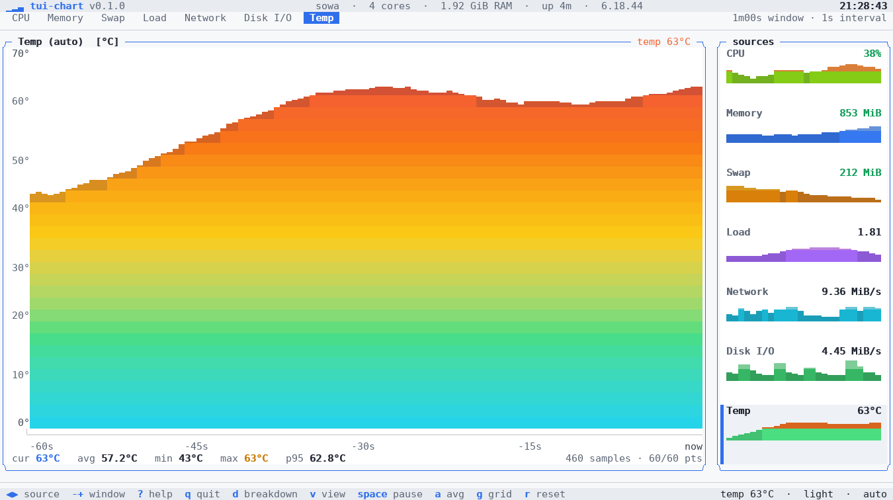
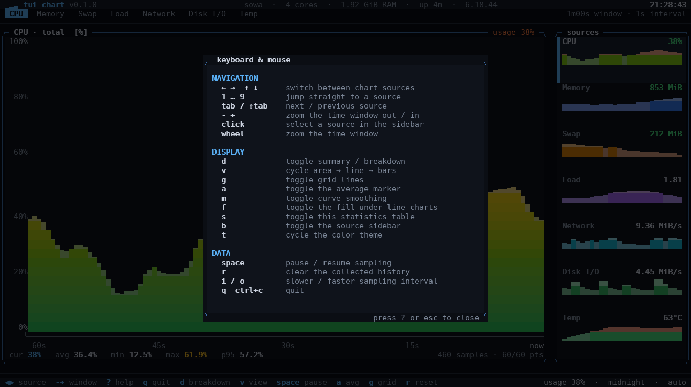

# tui-chart

High resolution live charts for the terminal, written in Go.

`tui-chart` reads system metrics from `/proc` and `/sys` and draws them as
sub-cell accurate charts: braille polylines, eighth-block gradient fills and
stacked band breakdowns. It is a monitoring dashboard first — one minute of
one-second samples on screen, arrow keys to move between metrics — and a
charting engine underneath that can also print a single chart to stdout.



*CPU usage, one sample per second, sixty second window, gradient area renderer.*

## Highlights

**Rendering**
- Sub-cell geometry: braille dots (2×4 per cell) for lines, eighth blocks
  (1/8 cell) for the top edge of fills, cell backgrounds for exact stacked
  band boundaries.
- Gamma correct gradients: colors interpolate in linear light, so ramps keep
  their luminance instead of going muddy in the middle.
- Three renderers — gradient **area**, braille **line** (with optional shaded
  fill) and gradient **bars** — switchable at runtime.
- Stacked breakdowns: CPU time components, memory used/cache/free, disk and
  network read/write.
- Axes that mean something: unit aware tick steps (`0/5/10/15 GiB`, not
  `4.66/9.31/13.97 GiB`), pinned ranges for bounded metrics, hysteresis so the
  axis does not jitter, relative time labels, dotted grid behind the data.
- Colour degradation: truecolor → 256 → 16 → none, plus `NO_COLOR` support and
  a colourless mode that still reads well.

**Interface**
- Live source sidebar with a sparkline and current value per metric; the active
  one is highlighted, click any card to focus it.
- Chart any shell command or stdin stream: numeric output becomes a source with
  the same history, zoom, statistics and renderers as the built-in metrics.
- Per-source summary/breakdown views, statistics strip (cur/avg/min/max/p95),
  statistics table, keyboard reference overlay.
- Six themes (midnight, nord, gruvbox, dracula, light, mono), pause/resume,
  window zoom, grid/average/smoothing toggles, sampling rate control.
- Adaptive layout: full dashboard with sidebar, or a chart-only view on narrow
  terminals; below 60×16 a short notice replaces the chart instead of drawing
  something clipped. Mouse clicks and wheel supported.

**Engineering**
- No CGO, no external runtime dependencies beyond a few small libraries
  (bubbletea for input/terminal handling).
- Visual regression tests: golden frames for every renderer, plus a PTY harness
  that runs the real binary and can turn any capture into a PNG.
- Fixture based metric tests: `/proc` and `/sys` readers are tested against
  recorded trees, including counter wraparound and rate calculations.
- External sources are ordinary `metrics.Source` implementations, so command
  and stdin data get the same sampling, history and rendering path as system
  metrics.

## Install

```sh
git clone https://github.com/c0m4r/tui-chart
cd tui-chart
go build ./cmd/tui-chart        # or: make build
./tui-chart                     # live dashboard, starting on CPU
```

Requires Go 1.24+ and Linux (`/proc`, `/sys`). Any terminal with truecolor
support looks best; 256 colour and 16 colour terminals are handled
automatically.

## Usage

```
tui-chart [flags]            start the interactive dashboard
tui-chart snapshot [flags]   print one chart to stdout and exit
tui-chart frame [flags]      render one dashboard frame to stdout
tui-chart sources            list the available metric sources
```

Common flags:

| flag | meaning |
| --- | --- |
| `-s, --source NAME` | metric to display first (`cpu`, `memory`, `swap`, `load`, `network`, `disk`, `temperature`) |
| `-i, --interval DUR` | sampling interval, `250ms`, `1s`, `5s` (default `1s`) |
| `-w, --window N` | samples shown on the chart (default `60`, i.e. one minute at 1/s) |
| `--history N` | samples kept in memory (default `900`) |
| `-r, --renderer NAME` | `area`, `line` or `bars` (default: the source's preference) |
| `--theme NAME` | `midnight`, `nord`, `gruvbox`, `dracula`, `light`, `mono` |
| `--color MODE` | `truecolor`, `256`, `16`, `none` (default: auto from the environment) |
| `--grid`, `--average`, `--smooth`, `--fill` | start with grid lines, mean marker, curve smoothing or shaded line charts |
| `--no-sidebar` | hide the source sidebar |
| `--demo` | synthetic data instead of live metrics — works without `/proc` |

External data can be charted as well:

| flag | meaning |
| --- | --- |
| `--stdin` | read one sample per line from standard input |
| `-c, --command CMD` | run a shell command every interval and chart its output; repeat for several series |
| `--label LIST` | comma separated series names, for example `rx,tx` |
| `--unit UNIT` | `none`, `percent`, `bytes`, `bytes/s`, `count`, `rate`, `celsius`, `watts`, `load` or `seconds` |
| `--timeout DUR` | command and stream read timeout (default `30s`) |
| `-- CMD` | shorthand for `--command CMD` |

The dashboard needs a terminal of at least **60×16** (columns × rows). Anything
smaller gets a short notice asking for a resize rather than a chart squeezed
into a space too small for it; `tui-chart snapshot` still prints a single chart
into spaces as small as 8×4.

```sh
tui-chart                          # dashboard, CPU first, 60 x 1s window
tui-chart -s memory                # start on the memory chart
tui-chart -i 500ms -w 120          # twice a second, two minute window
tui-chart --demo --theme nord      # explore the interface with synthetic data
tui-chart sources                  # what can be charted on this machine
tui-chart snapshot --demo -w 60 > chart.txt
```

### Charting commands and pipes

Anything that prints numbers can be a live chart with history. A single
command is run once per sampling interval:

```sh
tui-chart --command 'ps aux | wc -l'
tui-chart -i 2s --command 'sensors | awk "/Package id 0/ {print \$4}"'
tui-chart --command 'df / | awk "NR==2 {print \$4}"' --unit bytes
```

Repeat `--command` for multiple series, or let one command print several
numbers per sample:

```sh
tui-chart --label bash,ssh \
  -c 'pgrep -c bash || true' -c 'pgrep -c sshd || true'
```

Streams work the same way: one line is one sample, and every number on the
line becomes a series. Text around the numbers is ignored, so `temp=52.3C`
needs no preprocessing. If stdin is a pipe and no command is given,
`tui-chart` reads it automatically; the keyboard is then taken from the
controlling terminal, so all normal keys still work.

```sh
while true; do
  awk '{print $1}' /proc/loadavg
  sleep 1
done | tui-chart --stdin -i 1s

printf 'rx tx\n120 80\n150 90\n' | tui-chart --stdin --label rx,tx
```

`snapshot` and `frame` accept the same flags, which makes external data easy
to put in a script, a test or a screenshot:

```sh
seq 1 120 | tui-chart snapshot --stdin --samples 120 -w 120 > chart.txt
tui-chart snapshot --command 'echo 42' --samples 10 --height 12
```

For streams, set `--interval` to the producer's cadence so the time axis
labels match the data. Commands are sampled by `tui-chart` itself, so the
interval is exact there. A command that takes longer than the interval delays
the next update; `--timeout` caps a single run.

### Keys

| key | action |
| --- | --- |
| `←` `→` `↑` `↓` | switch between chart sources |
| `1`…`9` | jump straight to a source |
| `tab` / `shift+tab` | next / previous source |
| `-` `+` | zoom the time window out / in |
| `d` | toggle summary / breakdown (CPU time, memory split, rx/tx) |
| `v` | cycle area → line → bars |
| `g` `a` `m` `f` | grid, average marker, smoothing, fill under lines |
| `s` | statistics table for every series |
| `b` | show/hide the sidebar |
| `t` | cycle the colour theme |
| `space` | pause / resume sampling |
| `r` | clear the collected history |
| `i` `o` | slower / faster sampling |
| click, wheel | select a source, zoom the window |
| `?` | keyboard reference |
| `q`, `ctrl+c` | quit |

## Screenshots

CPU breakdown — stacked user/system/nice/iowait/irq/steal bands:



Memory breakdown — used / cache / free against the installed RAM:



Network — receive and transmit as braille polylines with a shaded fill:



Groups are per second, bars per sample:



Themes ship with the binary; `t` cycles them at runtime:




`?` opens the keyboard reference without leaving the dashboard:



## How it works

```
cmd/tui-chart        CLI: flags, dashboard, snapshot and frame modes
internal/chart       rendering engine (no knowledge of system metrics)
  canvas.go          cell grid + braille dots, ANSI emission, colour modes
  plot.go            column profiles, area/line/bars renderers, sub-cell fills
  chart.go           axes, grid, scales, legends, sparklines
  scale.go           nice tick selection, unit aware formatting
  series.go          ring buffers, statistics
  color.go           ramps, gamma correct blending, palette quantisation
internal/metrics     /proc and /sys collectors exposed as chart series,
                     plus command and stdin sources (external.go)
internal/ui          bubbletea model: layout, panels, sidebar, overlays, input
tools/ansipng        ANSI/VT capture → PNG renderer (verification tool)
tools/ptytest        PTY driver that runs the real binary and captures output
```

**Sub-cell resolution.** A terminal cell is a coarse pixel, so the engine
carries more than one sample per cell. Braille patterns give 2×4 dots per cell
for lines; eighth blocks give 1/8 cell vertical resolution for the top edge of
a filled area; stacked bands claim the space above a neighbour's partial cell by
painting the cell *background* instead of overdrawing its glyph. Dense data is
reduced with a min/max envelope so spikes survive downsampling, and sparse data
is interpolated (optionally Catmull-Rom smoothed) so the curve stays
continuous.

**Scales.** `niceStep` searches for the smallest 1/2/2.5/5/10 × 10ⁿ step that
keeps the tick count under the available rows, in the unit the axis is labelled
in — so a 32 GiB memory axis steps in whole GiB. Metrics with natural bounds
(percentages, RAM size, swap size) pin the axis; the rest get a stabilised auto
range that only moves when the data leaves it with slack.

**Sampling.** Every source is sampled on the UI tick, so the sidebar is always
live. Rates (network, disk) are computed from cumulative counters with
elapsed-time normalisation and clamp to zero when a counter resets. Sources
that need a baseline silently skip their first reading.

## Development

```sh
make build          # build the binary
make test           # unit tests (golden frames included)
make test-update    # rewrite the golden frames after an intentional change
make vet fmt        # static checks
make screenshots    # regenerate docs/*.png from the frame renderer
make integration    # drive the real binary under a PTY and capture it
```

The verification tooling is part of the repository:

- `tools/ansipng/ansipng.py` is a small terminal emulator that replays a raw
  capture and renders it to PNG with pixel accurate braille dots, block
  elements and box drawing. It is how every screenshot in this README was
  produced, and how the visual changes were reviewed.
- `tools/ptytest/capture.py` runs the compiled binary on a pseudo terminal of a
  chosen size, answers the terminal capability queries a real emulator would,
  sends keys and resize events on a schedule and stores the byte stream.

```sh
# run the dashboard in demo mode, press right/right/d/?, then screenshot it
python3 tools/ptytest/capture.py --cols 150 --rows 42 --settle 1.0 \
  --keys "1.0:right,0.6:right,0.6:d,0.6:?,1.0:esc" \
  --out /tmp/run.bin -- ./tui-chart --demo
python3 tools/ansipng/ansipng.py /tmp/run.bin /tmp/run.png -w 150 -r 42
```

### Adding a metric source

Implement `metrics.Source` (or embed `metrics.base` for the bookkeeping) in
`internal/metrics`, then add the constructor to the list in `metrics.All`.
A source provides an id, a title, a unit, one or more series with colour ramps,
a `Sample()` method, and optionally a breakdown view and a fixed value range.

### Adding a theme

Add an entry to `ui.Themes` in `internal/ui/theme.go`. Themes are plain colour
values, so a new one is a dozen lines and immediately available via `--theme`
and the `t` key.

## Limitations

- Linux only: metrics come from `/proc` and `/sys`.
- The live dashboard needs a terminal of at least 60×16; smaller windows show a
  resize notice instead of a chart (`tui-chart snapshot` works down to 8×4).
- The chart shows what the process sees; containerised environments may report
  host counters.
- Command sources run synchronously on the sampling tick, so a command slower
  than the interval limits the refresh rate; use `--timeout` to bound it.
  Streams carry no timestamps, so set `--interval` to the producer's cadence.
- Braille glyph rendering depends on the terminal font. Every common monospace
  font renders the pattern, but fonts without braille coverage fall back to
  empty cells — use `v` to switch to bars, or `--renderer bars`.
- Sub-cell precision is limited to 1/8 cell vertically for block fills and
  1/4 cell for braille dots; anything finer is quantised.

## License

```
    tui-chart - High resolution live charts for the terminal, written in Go.
    Copyright (C) 2026  c0m4r

    This program is free software: you can redistribute it and/or modify
    it under the terms of the GNU Affero General Public License as published
    by the Free Software Foundation, either version 3 of the License, or
    (at your option) any later version.

    This program is distributed in the hope that it will be useful,
    but WITHOUT ANY WARRANTY; without even the implied warranty of
    MERCHANTABILITY or FITNESS FOR A PARTICULAR PURPOSE.  See the
    GNU Affero General Public License for more details.

    You should have received a copy of the GNU Affero General Public License
    along with this program.  If not, see <https://www.gnu.org/licenses/>.
```
